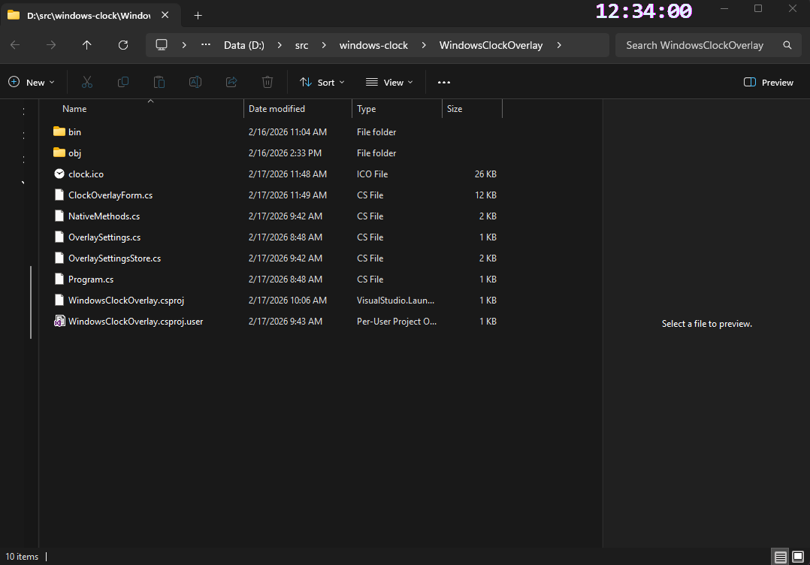
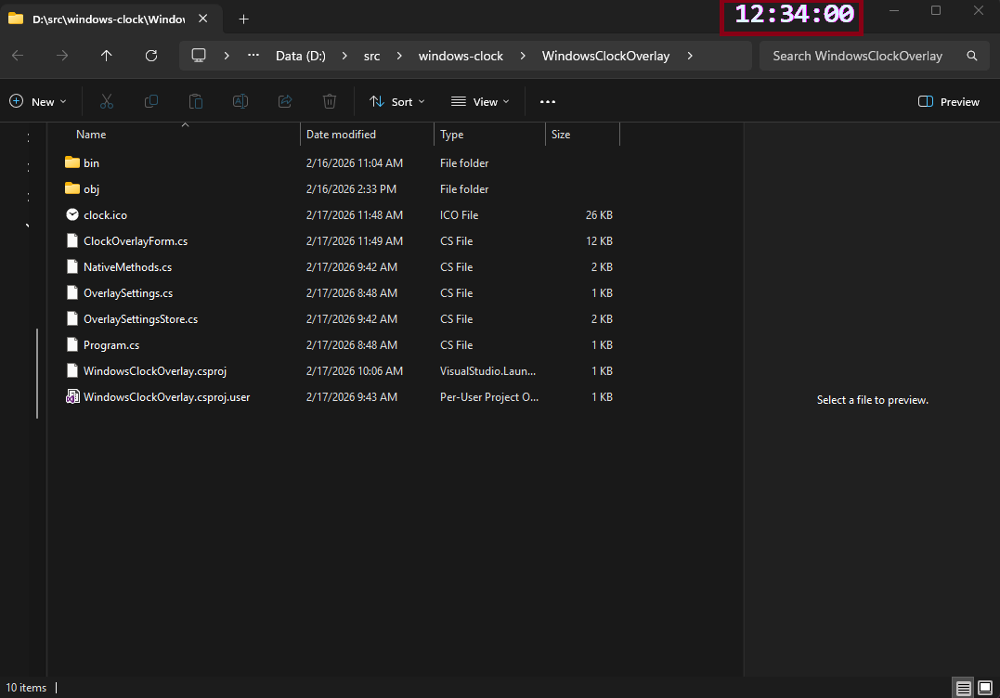

# Windows Clock Dashboard

A compact Windows taskbar dashboard with three display modes: an overlay positioned in the existing Windows 11 taskbar, a native AppBar strip above the taskbar, and the legacy floating overlay.

## Why this exists

When gaming, streaming, or watching videos in fullscreen, it is annoying to tab out just to check the time or a device battery. Taskbar Anchored places the clock and Bluetooth battery indicators in a selected region of the existing taskbar without reserving desktop workspace. The default region is the far-left area after the Widgets/weather button and before the centered task-list group.

## Features

- Taskbar Anchored clock (`HH:mm:ss`) and Bluetooth battery indicators inside a detected safe taskbar region
- Automatic Bluetooth discovery and Windows-reported battery percentages through Configuration Manager device properties
- Background refresh every 30 seconds by default; no PowerShell subprocesses or UI-thread device reads
- Configurable widget visibility and order, Bluetooth device visibility and aliases, refresh interval, low and critical thresholds, and compact spacing
- Far-left, center-gap, and right-gap placement regions, separate from left/center/right alignment
- Dashboard width calculated from enabled widgets and constrained by the selected safe region
- Taskbar AppBar clock with a reserved strip above the taskbar, available as an explicit mode
- Legacy transparent, always-on-top overlay mode
- Ctrl + mouse wheel zoom in legacy overlay mode
- Position, color, font size, and horizontal offset persistence
- 12 built-in color presets in tray menu
- Lightweight WinForms app with no runtime dependencies beyond .NET 8

If space becomes constrained, lower-priority widgets are hidden and a small `!` status indicator is shown when it fits. The dashboard stays in Taskbar Anchored mode and does not silently switch to AppBar or the floating overlay.

## Download

Use prebuilt binaries from the GitHub Releases page:

- https://github.com/jrvelloso/windows-clock-overlay/releases/latest

If no release is available yet, build from source.

Direct download:

- https://github.com/jrvelloso/windows-clock-overlay/releases/latest/download/WindowsClockOverlay-win-x64.zip

## Run from source

```powershell
cd .\WindowsClockOverlay
dotnet run
```

## Build release binary

```powershell
dotnet publish .\WindowsClockOverlay\WindowsClockOverlay.csproj -c Release -r win-x64 --self-contained false
```

Output:

`WindowsClockOverlay\bin\Release\net8.0-windows\win-x64\publish\WindowsClockOverlay.exe`

## Usage

- Right-click the tray icon and choose **Display Mode** to switch between **Taskbar Anchored**, **Taskbar AppBar**, and **Legacy Clock Overlay**.
- Taskbar Anchored reads the primary `Shell_TrayWnd` rectangle with `GetWindowRect`, then independently measures the Widgets button, centered task-list group, and notification area. It places a borderless, non-activating WinForms overlay inside the selected region with a 6-DIP control safety margin. It does not register an AppBar or reserve desktop workspace.
- **Taskbar Anchored Layout...** selects `FarLeft`, `CenterGap`, or `RightGap` independently from horizontal alignment. `FarLeft` is the default and starts after the Widgets button with an 8-DIP margin. If UI Automation cannot locate Widgets, a configurable 180-DIP inset is used and logged. Width is calculated from enabled widgets; lower-priority widgets are hidden with a `!` status when space is limited.
- If the selected region cannot fit the dashboard, Taskbar Anchored remains selected and the dashboard stays hidden. A notification and the tray menu explain the failure. Choose **Taskbar AppBar** or **Legacy Clock Overlay** in **Display Mode** to switch explicitly.
- The tray menu shows requested and effective display modes. Diagnostics are appended to `%LOCALAPPDATA%\WindowsClockOverlay\diagnostics.log`.
- Use **Taskbar Anchored Layout...** to select the placement region and alignment, and configure the safe-area margin, far-left fallback inset, and optional extra horizontal offset. Width is calculated automatically. The old saved width is retained for settings compatibility.
- Use **Dashboard and Bluetooth Devices...** to configure widget order and visibility, device visibility and aliases, battery refresh interval, battery thresholds, and compact spacing.
- Dragging and Ctrl + mouse wheel zoom are available only in Legacy Clock Overlay mode.
- Right-click the tray icon to change clock color, reset overlay position, configure the dashboard, or exit.
- Taskbar Anchored is the preferred mode. Settings without a saved display mode migrate to Taskbar Anchored while preserving existing position, color, font, offset, and legacy width values.

## Settings

Settings are stored at `%LOCALAPPDATA%\WindowsClockOverlay\settings.json`. Older files receive defaults for the clock and Bluetooth battery widgets, a 30-second refresh, 30% low and 15% critical thresholds, compact spacing, and the `FarLeft` placement region. Existing display mode, position, color, font, dashboard width, and horizontal offset values are retained. `TaskbarDashboardWidthDip` remains serialized for backward compatibility; Taskbar Anchored calculates its actual width from visible widgets and the selected live safe region.

## Windows 11 limitations

- Taskbar Anchored currently supports a visible bottom taskbar on the primary display. Other edges and secondary-display taskbars leave the dashboard hidden until the user explicitly selects another display mode.
- The Widgets button is discovered through UI Automation; centered task-list and notification-area child window class names are Windows shell implementation details, not a supported taskbar extension API. If Widgets cannot be discovered, the configured far-left inset is used. If required bounds are missing, the region is too small, or a collision is detected, the dashboard records the reason and stays hidden rather than moving to another region.
- Taskbar geometry is polled twice per second and refreshed on display and DPI changes. Explorer restarts are detected with `TaskbarCreated` and the same geometry checks.
- In Taskbar Anchored mode, a foreground window that covers the primary display causes the dashboard to hide and drop out of the topmost band. It returns after fullscreen ends to avoid covering unrelated fullscreen applications.
- Bluetooth discovery reads present `BTHENUM` and `BTHLE` device nodes and the Windows battery property `{104EA319-6EE2-4701-BD47-8DDBF425BBE5} 2` through `CfgMgr32.dll`. A device without a valid Windows-reported property is shown as unavailable (`--`); a valid `0%` is distinct. The app reads the property again on each refresh and clears values on a scan failure or disconnect instead of presenting an app-cached value as current.
- Taskbar Anchored is an overlay positioned over a safe taskbar gap, not a native taskbar extension. The app does not modify or inject code into Windows Explorer.

## Screenshots

Taskbar Anchored screenshot placeholder (capture after Windows 11 positioning validation).

Clock visible in Windows Explorer:



Clock highlighted for visibility:



## Automated tests

Run the test suite on Windows with:

```powershell
dotnet test .\windows-clock.sln
```

The tests cover battery property validation, Bluetooth profile deduplication, disconnect and reconnect state transitions, constrained widget layout, and settings migration and serialization.

## Manual verification checklist

- [ ] Start and exit in all three display modes; confirm Taskbar Anchored does not reserve workspace and AppBar releases it on exit.
- [ ] Verify the clock and battery indicators stay inside the selected region; confirm the default far-left region begins after Widgets and does not cover taskbar controls.
- [ ] Configure widget order, visibility, device aliases, thresholds, and refresh interval; verify they persist after restart.
- [ ] Fill the gap with pinned or running apps and verify lower-priority widgets hide with a status indicator while Taskbar Anchored remains selected.
- [ ] Compare battery percentages with the corresponding Windows PnP property; check `0%`, unavailable, disconnect, and reconnect states.
- [ ] Check that maximized windows stop above the AppBar when AppBar is explicitly selected.
- [ ] Restart Windows Explorer and confirm Taskbar Anchored returns.
- [ ] Check scaling at 100%, 125%, and 150%, and change display resolution.
- [ ] Check taskbar auto-hide and switching between all modes.
- [ ] Check a multi-monitor setup and confirm Taskbar Anchored stays on the primary display.
- [ ] Open an unrelated fullscreen application and confirm the anchored dashboard hides until fullscreen ends.

## Fullscreen behavior

The legacy overlay works over normal windows and borderless fullscreen windows. Taskbar Anchored hides when a foreground window covers the primary display. AppBar mode retains its reserved-strip behavior and needs manual verification with fullscreen applications.

## Contributing

Issues and PRs are welcome. See:

- `CONTRIBUTING.md`
- `.github/ISSUE_TEMPLATE/bug_report.yml`
- `.github/ISSUE_TEMPLATE/feature_request.yml`

## Support

If this project helps you, you can support development on Ko-fi:

- [ko-fi.com/jrvelloso](https://ko-fi.com/jrvelloso)

## Roadmap

- CPU, RAM, network, and temperature widgets
- Optional 12h format
- Optional custom fonts
- Optional startup with Windows
- winget package

## License

MIT. See `LICENSE`.
